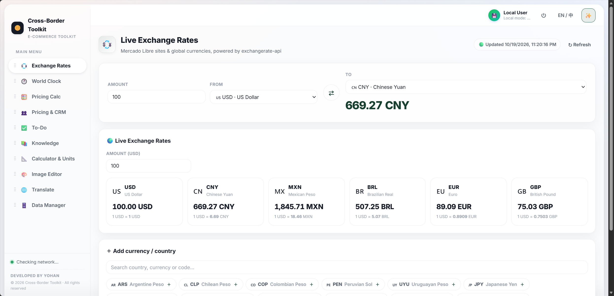

# 跨境百宝囊 · Cross-Border Toolkit

> 🇬🇧 **English** — Ten tools for cross-border sellers in one static page: exchange rates,
> a Mercado Libre pricing calculator that works backwards from your target margin, CRM,
> to-dos, knowledge base, an 18-language translator, batch image editing, unit conversion,
> world clock, JSON backup. No framework, no build step, no npm.
> Data stays in your browser's IndexedDB by default; bring your own Supabase for sync.
> **The UI itself supports English** — click the "中 / EN" button in the top bar.
> Full documentation below is in Chinese. MIT licensed.

> 跨境电商卖家的一站式工具台 —— 汇率、定价、客户、待办、知识库、翻译、图片处理，
> 全部装在一个**纯静态页面**里。零构建、零依赖、双击即用。



[](LICENSE)
[](.)
[](.)

---

## 两种版本，选你需要的那个

| | 🟢 纯本地版 | 🔵 完整版 |
|---|---|---|
| 目录 | [`packages/local`](packages/local) | [`packages/full`](packages/full) |
| 部署方式 | 上传静态文件即可 | 上传静态文件（+ 可选 Supabase） |
| 数据存在哪 | 浏览器 IndexedDB | 浏览器 IndexedDB **或** 你自己的 Supabase |
| 账号系统 | 无 | 有（邮箱注册，首个用户自动成为管理员） |
| 多人协作 | ❌ | ✅ 成员管理、角色、数据分享 |
| 需要服务器 | ❌ 不需要 | ❌ 不需要（Supabase 是托管服务） |
| 适合谁 | 个人单机使用、注重隐私、想零成本长期挂着 | 团队共用一份数据、需要多设备同步 |

> 两个版本共用同一套界面与模块代码，区别只在「有没有云端」。可以随时从纯本地版升级到完整版，
> 用「数据管理 → 导出/导入」把数据搬过去即可。

---

## 功能一览

| 模块 | 能做什么 |
|---|---|
| 💱 **汇率换算** | 多币种实时汇率、批量换算、离线缓存兜底 |
| 🕐 **世界时钟** | 城市搜索、多时区并排对照 |
| 🧮 **定价计算器** | 成本 → 售价推演，佣金/运费/体积重/利润率，多方案对比 |
| 👥 **客户档案 + 定价记录** | CRM 联系人、跟进记录、自定义字段与标签 |
| ✅ **日程待办** | 优先级、按平台/自定义标签筛选、逾期提醒 |
| 📚 **知识库** | 官方库 + 私有库、标签体系、文案模板库（多语言译文一键归档） |
| 📐 **计算器 + 单位换算** | 9 大类单位互转、带括号与百分号的表达式计算器、全键盘支持 |
| 🌐 **翻译** | 18 种语言一次性多目标翻译；免费引擎 / 自填 DeepSeek Key / 自建云函数三选一 |
| 🎨 **图片编辑** | 压缩 / 水印 / 裁切，批量处理，支持 URL 导入（全本地处理） |
| 🗄️ **数据管理** | 导出/导入 JSON 备份、定时自动备份、清空数据 |

另外还有：中英双语界面、**三态外观一键切换**（经典 / 夜间 / Lumen 玻璃拟态，顶栏 🎨 按钮循环切换）、可插拔皮肤（[Lumen](packages/full/css/themes/lumen)）、移动端适配。

---

## 30 秒跑起来

```bash
git clone https://github.com/YOHANNKO/E-commerce-Toolkit.git
cd E-commerce-Toolkit/packages/local
python3 -m http.server 3000
# 或 npx serve .
```

打开 <http://localhost:3000>，点「进入本地模式」即可。

> 不想 clone？直接下载仓库 ZIP（右侧 **Releases** 或绿色 Code 按钮里都有），
> 解压后进 `packages/local`，起一个静态服务器
> （`python3 -m http.server` / `npx serve` / VS Code 的 Live Server 都行）。
> 不装任何东西、不用 npm install、没有构建步骤。

> ⚠️ 不要直接双击 `index.html`。`file://` 协议下浏览器会禁用 IndexedDB，数据存不住。
> 部署到线上（GitHub Pages / Vercel / Netlify / 自己服务器）则没有这个问题。

---

## 部署

两个版本都是**纯静态文件，没有构建步骤**。

| 平台 | 做法 |
|---|---|
| GitHub Pages | 本仓库已内置工作流，推送到 `main` 自动发布 `packages/full` |
| Vercel / Netlify | 拖拽对应目录，构建命令**留空**，输出目录填 `/` |
| Cloudflare Pages | Upload assets 直接上传目录 |
| 腾讯云 CloudBase | 静态托管 → 拖文件到根目录 |
| 自有服务器 | 丢进 Nginx / Apache 网站根目录 |

详细步骤见 [docs/纯本地版部署说明.md](docs/纯本地版部署说明.md)。

---

## 完整版的云端模式（可选）

只需要两步，全程在 Supabase 控制台点鼠标：

1. **建表**：新建 Project → SQL Editor → 按编号依次执行 `packages/full/supabase/migrations/0001~0008`（全部幂等，可重复执行）
2. **填配置**：把 Project URL 与 anon key 写进 `packages/full/js/config.local.js`（从 `config.local.js.example` 复制）。
   同时在 `packages/full/js/config.js` 里填上任意非空占位值（比如 `"placeholder"`），
   `index.html` 检测到 `config.js` 已填值才会去加载 `config.local.js` 做覆盖。

细节见 [packages/full/README.md](packages/full/README.md)。

> 🔐 **密钥安全**：`js/config.local.js` 已被 `.gitignore` 忽略，永远不会进仓库。
> `anon key` 本身可以公开（真正的防线是数据库 RLS）；`service_role key` 任何情况下都不要放进前端。

---

## 这个项目刻意不做的事

- ❌ 不引入任何框架或构建工具（没有 webpack/vite/npm install）
- ❌ 不依赖任何后端服务才能运行
- ❌ 不收集任何用户数据、不埋点、不接入统计 SDK
- ❌ 不需要注册账号才能用

第三方请求只有三处，且只在你使用对应功能时发生：汇率（`jsdelivr` / `open.er-api.com` 双源兜底）、城市搜索（`open-meteo.com`）、免费翻译（Google 免费端点 / Lingva / MyMemory 三级兜底）。
字体已自托管（`fonts/*.woff2`），**不依赖 Google Fonts**，国内网络可正常加载。

---

## 目录结构

```
.
├── packages/
│   ├── local/          # 纯本地版（推荐新手）
│   │   ├── index.html
│   │   ├── css/ js/ fonts/
│   └── full/           # 完整版（含 Supabase 云端协作）
│       ├── index.html
│       ├── css/ js/ fonts/
│       └── supabase/migrations/   # 0001~0008 建库脚本
├── docs/
│   ├── 纯本地版部署说明.md
│   ├── GitHub开源操作手册.md      # 上传/发布/打 tag 全流程
│   └── screenshot-rates.png       # README 顶部截图
├── .github/workflows/ci.yml       # 语法检查 + 密钥扫描 + Pages 部署
├── CONTRIBUTING.md
├── SECURITY.md
└── LICENSE
```

---

## 许可

[MIT](LICENSE)。可自由用于个人与商业项目，修改、分发、闭源商用均允许，保留版权声明即可。

字体 [Inter](https://github.com/rsms/inter) 遵循 SIL Open Font License 1.1。
Supabase SDK（`js/vendor/supabase.umd.js`）遵循 Apache-2.0。

---

## 贡献

欢迎 Issue 与 PR，请先读 [CONTRIBUTING.md](CONTRIBUTING.md)。安全问题请按 [SECURITY.md](SECURITY.md) 私下报告。
